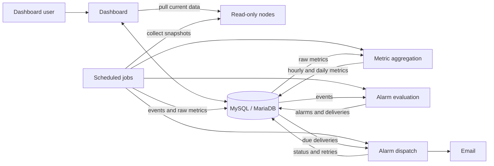

<div align="center">
  

# MATA Dashboard

[![CI][CI-shield]][ci-url]
[![License][license-shield]][license-url]
[![HTMX][HTMX-shield]][empty-url]
![PHP 8.3+][PHP-shield]

Monitoring for environments where a full observability stack is impractical:
shared hosting, small VPS boxes, legacy servers. Anywhere you can run PHP 8.3.

One dashboard polls one or more read-only nodes over HTTPS, stores events and
metrics in MySQL/MariaDB, evaluates alarms, and sends email. Minimal dependencies, no Node runtime, no JavaScript framework. 

[![Screenshot][product-screenshot]][demo-url]

[Try the live demo][demo-url]

User: **demo** | Password: **demo**

</div>

## How it works

- The central dashboard collects data and evaluates/delivers alarms. 
- Nodes are stateless and offer read-only endpoints.



The dashboard serves the UI and pulls node data on demand. Cron does the
scheduled work: collect snapshots, persist events and metrics, evaluate alarms,
dispatch due deliveries, clean up retained data. The dashboard still renders
monitors functionality of applications when the database is down; everything else needs it.

[MATA Node](https://github.com/mata-sh/mata-node) is a separate application,
installed on each monitored host.

## Security model

- **Pull-only.** Traffic is only dashboard → node.
- **HMAC + short TTL.** Per-node shared secret; every request carries a
  timestamped token. Full handshake in
  [security architecture](docs/architecture/security.md#node-authentication).
- **Optional IP allowlists** on dashboard and node endpoints.
- **Rate limiting** on dashboard and node APIs.
- **File-based users, CLI-only management** with an audit log, so sign-in
  still works when the database does not.
- **Policy as code.** Alarm decisions are Rego policies in `policy/`, unit-tested
  with OPA in CI; the same policies validate the shipped config examples.
- **Configurable retention** for events and logs.

[`SECURITY.md`](SECURITY.md) covers vulnerability reporting and supported
versions. See [Secure an installation](docs/guides/secure-application.md) for
the production baseline.

## What is collected

Collected from nodes:

- CPU, RAM, disk
- Top process snapshot
- HTTP status, and latency
- Recent log lines
- Session counts
- Composer package inventory (names and versions)
- Application metadata

Not collected: secrets, environment variables, database contents, source code.
What a node exposes is what the node is configured to expose — a
misconfigured node can leak more than intended.

## Alarm model

| Term | Meaning |
| --- | --- |
| Event | A recorded fact. |
| Logical alarm | A stored alarm associated with an event. |
| Delivery | One channel attempt for a logical alarm. Email is the only implemented channel. |

Notification rules select channels for policy-evaluated alarms. Direct
emergency alarms (configuration failures) bypass both the rules and the
decision driver.

Decisions come from OPA (`policy/*.rego`) where it can run, or from a
deliberately limited built-in driver where it cannot; see
[`ALARM_DECISION_DRIVER`](docs/reference/alarms.md).

## Requirements

- PHP 8.3+, Composer, `make`
- MySQL or MariaDB for events, alarms, deliveries, historical metrics, migrations
- A web server pointed at `public/`
- Cron, or any equivalent scheduler
- Optional: OPA for alarm decisions, Docker for the containerised setup

## Setup

```bash
git clone https://github.com/mata-sh/mata-dashboard.git
cd mata-dashboard
make setup          # asks for local|docker and dev|demo|prod, writes .mata.mk
make db-migrate
make doctor
```

`MODE=... ENV=...` skips the prompts. See the
[quick start](docs/guides/quickstart.md) or
[Docker quick start](docs/guides/quickstart-docker.md), then
[add your first server](docs/guides/first-server.md).

## Scheduled jobs

`cron/crontab.shared-hosting.template` is the reference schedule; Docker
installs the same manifest as the `www-data` crontab.

| Job | Does |
| --- | --- |
| `servers_data_fetch.php` | Pulls application data, records events, warms the API cache |
| `servers_metrics_collect.php` | Writes raw server snapshots (chained after the fetch, reusing the warm cache) |
| `servers_metrics_aggregate.php` | Rolls raw rows up to hourly and daily |
| `libraries_audit.php` | Refreshes expired Composer audits and records new security advisories |
| `alarms_evaluate_{critical,non_critical}.php` | Turns events into logical alarms |
| `alarms_dispatch.php` | Sends due deliveries |
| `retention_cleanup.php` / `rate_limit_cleanup.php` | Expire database rows and file-based rate-limit state |

## Scope

MATA began as an internal tool for monitoring PHP deployments with limited hosting access.

**Ideal for**

- Agencies managing dozens of customer servers
- A handful to roughly 100 nodes and teams of 1 to 20 people
- PHP applications across legacy and modern stacks
- Shared hosting, small VPSs, and other restricted environments
- Monitoring failures across many small servers without SSH hopping

**Not for**

- Public or multi-tenant dashboards
- Large user populations
- Kubernetes or large-scale observability

## Documentation

Full docs in [`docs/`](docs/index.md):
[architecture](docs/architecture/overview.md) ·
[technology choices](docs/architecture/technology-choices.md) ·
[configuration](docs/guides/configuration.md) ·
[server metrics pipeline](docs/architecture/server-metrics-pipeline.md) ·
[development setup](docs/development/development-setup.md)

Contributions: [`CONTRIBUTING.md`](CONTRIBUTING.md).
Bugs and feature requests go to [issues](https://github.com/mata-sh/mata-dashboard/issues).

## License

Apache License 2.0 [`LICENSE`](LICENSE). Bundled third-party assets keep
their own licenses; see [`THIRD_PARTY_NOTICES.md`](THIRD_PARTY_NOTICES.md).

## Contact

xarc | mata@xarc.dev

<!-- MARKDOWN LINKS & IMAGES -->
[license-shield]: https://img.shields.io/github/license/mata-sh/mata-dashboard.svg?style=for-the-badge
[PHP-shield]: https://img.shields.io/badge/PHP-8.3%2B-777BB4?style=for-the-badge&logo=php&logoColor=white
[HTMX-shield]: https://img.shields.io/badge/HTMX-36C?style=for-the-badge&logo=htmx&logoColor=fff
[CI-shield]: https://img.shields.io/github/actions/workflow/status/mata-sh/mata-dashboard/ci.yml?branch=main&style=for-the-badge

[product-screenshot]: docs/images/screenshot.jpg
[license-url]: https://github.com/mata-sh/mata-dashboard/blob/main/LICENSE
[ci-url]: https://github.com/mata-sh/mata-dashboard/actions/workflows/ci.yml
[demo-url]: https://demo.mata.sh
[empty-url]: #
