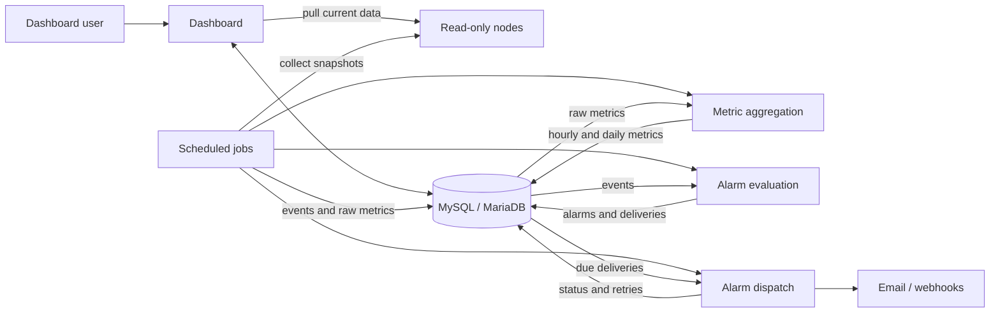

<div align="center">
  

# MATA Dashboard

[![CI][CI-shield]][ci-url]
[![License][license-shield]][license-url]
[![HTMX][HTMX-shield]][empty-url]
![PHP 8.3+][PHP-shield]

Security and health monitoring for PHP applications where a full observability
stack is impractical: shared and managed hosting, small VPS boxes, legacy
servers. Anywhere you can run PHP 8.3.

Know which of your sites run Composer packages with known vulnerabilities,
which new advisories affect your stack, and which applications throw errors
nobody has reported yet.

One dashboard polls read-only nodes over HTTPS, audits their dependencies,
watches advisory sources, stores events and metrics in MySQL/MariaDB, evaluates
alarms, and sends them by email or webhook. Minimal dependencies, no Node
runtime, no JavaScript framework.

[![Screenshot][product-screenshot]][demo-url]

[Try the live demo][demo-url] · [Documentation][docs-url]

User: **demo** | Password: **demo**

</div>

## How it works

- The central dashboard collects data and evaluates/delivers alarms.
- Nodes are stateless and offer read-only endpoints.



The dashboard serves the UI and pulls node data on demand. Cron does the
scheduled work: collect snapshots, persist events and metrics, evaluate alarms,
dispatch due deliveries, clean up retained data. The dashboard still shows live
application status when the database is down; everything else needs it.

[MATA Node](https://github.com/mata-sh/mata-node) is a separate application,
installed on each monitored host.

## Security model

- **Pull-only.** Traffic is only dashboard → node.
- **HMAC + short TTL.** Per-node shared secret; every request carries a
  timestamped token. Full handshake in
  [security architecture](docs/architecture/security.md#node-authentication).
- **Optional IP allowlists** on dashboard and node endpoints.
- **Rate limiting** on dashboard and node APIs.
- **File-based users, CLI-only management** with an audit log, so sign-in
  still works when the database does not.
- **Policy as code.** Alarm decisions are Rego policies in `policy/`, unit-tested
  with OPA in CI; the same policies validate the shipped config examples.
  Installations add their own overrides in `config/policy/`.
- **Configurable retention** for metrics, events, and alarms.

[`SECURITY.md`](SECURITY.md) covers vulnerability reporting and supported
versions. See [Secure an installation](docs/guides/secure-application.md) for
the production baseline.

## What is collected

Collected from nodes:

- CPU, RAM, disk
- Top process snapshot
- HTTP status and latency
- Recent log lines
- Session counts
- Composer package inventory (names and versions)
- Application metadata

Not collected: secrets, environment variables, database contents, source code.
What a node exposes is what the node is configured to expose.

## Vulnerability tracking

- **Dependency audits.** Nodes run `composer audit` for every application with
  Composer enabled. Each advisory new to an application is recorded once,
  as a critical event when it is rated high or critical. The **Audit** page
  shows every application's audit across all servers. See
  [Application error monitoring](docs/guides/application-error-monitoring.md).
- **Advisory sources.** The dashboard watches RSS/Atom feeds, GitHub repository
  advisories, IMAP mailboxes, OSV.dev packages and CSAF providers. The first
  poll of a source is a silent baseline; after that, keyword and severity
  filters decide what is relevant and each new match alarms once. The
  **Advisories** page lists sources and advisories, and a scheduled digest
  mails PDF, Markdown, HTML or JSON reports. See
  [Security advisories](docs/guides/security-advisories.md).

## Alarm model

| Term | Meaning |
| --- | --- |
| Event | A recorded fact. |
| Logical alarm | A stored alarm associated with an event. |
| Delivery | One channel attempt for a logical alarm, by email or webhook (for example Telegram). |

Notification rules select channels for policy-evaluated alarms. Direct
emergency alarms (configuration failures) bypass both the rules and the
decision driver.

Decisions come from OPA (`policy/*.rego`) where it can run, or from a
deliberately limited built-in driver where it cannot; see
[`ALARM_DECISION_DRIVER`](docs/reference/alarms.md).

## Configuration as code

There is no settings UI. Configuration is plain files: JSON for monitoring,
`.env` for credentials and per-host settings, Rego for alarm decisions.

- **Versionable.** The application repository ignores `config/`, so it can be
  its own Git repository with history, diffs and rollback; credentials stay in
  ignored files. See [Version your config](docs/guides/version-config.md).
- **Overridable policies.** `policy/` ships and updates with the dashboard.
  Local policies in `config/policy/` build on it and are versioned with your
  configuration. See [Local policy overrides](docs/reference/alarms.md#local-policy-overrides).
- **Validated.** `bin/mata config validate` checks every file and `make opa-test`
  the policies; both fit a pre-commit hook.
- **Scriptable.** Every `bin/mata` command takes `--json` and documents its exit
  codes.
- **Agent ready.** `config.example/AGENTS.md` gives coding agents the rules for
  a configuration repository, and [Install with a coding agent](docs/guides/agent-install.md)
  is a non-interactive runbook. Read-only commands such as `bin/mata logs show`
  return the dashboard's data as JSON. Agents can read the whole documentation
  as Markdown from [`llms-full.txt`](https://docs.mata.sh/llms-full.txt).

## Requirements

- PHP 8.3+, Composer, `make`
- MySQL or MariaDB for events, alarms, deliveries, historical metrics, migrations
- A web server pointed at `public/`
- Cron, or any equivalent scheduler
- Optional: OPA for alarm decisions, Docker for the containerised setup

## Setup

```bash
git clone https://github.com/mata-sh/mata-dashboard.git
cd mata-dashboard
make setup          # asks for native|docker and dev|demo|prod, writes .mata.mk
make db-migrate
make doctor
```

`MODE=... ENV=...` skips the prompts. See the
[quick start](docs/guides/quickstart.md) or
[Docker quick start](docs/guides/quickstart-docker.md), then
[add your first server](docs/guides/first-server.md).

## Scheduled jobs

`cron/crontab.shared-hosting.template` is the reference schedule; Docker
installs the same manifest as the `www-data` crontab.

| Job | Does |
| --- | --- |
| `servers_data_fetch.php` | Pulls application data, records events, warms the API cache |
| `servers_metrics_collect.php` | Writes raw server snapshots (chained after the fetch, reusing the warm cache) |
| `servers_metrics_aggregate.php` | Rolls raw rows up to hourly and daily |
| `libraries_audit.php` | Refreshes expired Composer audits and records new security advisories |
| `advisories_poll.php` / `advisories_digest.php` | Polls advisory sources and records new matches / mails the advisory digest when due |
| `alarms_evaluate_{critical,non_critical}.php` | Turns events into logical alarms |
| `alarms_dispatch.php` | Sends due deliveries |
| `retention_cleanup.php` / `rate_limit_cleanup.php` | Expire database rows and file-based rate-limit state |
| `cron_history_cleanup.php` | Removes heartbeat history of deleted cron jobs |

## Scope

MATA began as a minimalistic tool for monitoring PHP deployments with limited hosting access.

**Ideal for**

- Agencies managing dozens of customer servers
- Knowing which client sites run vulnerable dependencies, in one place
- A handful to roughly 100 nodes and teams of 1 to 20 people
- PHP applications across legacy and modern stacks
- Shared hosting, small VPSs, and other restricted environments
- Monitoring failures across many small servers without SSH hopping

**Not for**

- Public or multi-tenant dashboards
- Large user populations
- Kubernetes or large-scale observability

## Project status

MATA is used in production by the team that builds it, to monitor client
applications across managed hosting and small VPSs. It is pre-1.0:
configuration and the node API can still change between minor releases, and
the [changelog](CHANGELOG.md) lists the action each upgrade needs.

It is maintained by one developer alongside other work. There is no support
agreement or guaranteed response time. Bug reports and questions are welcome
in [issues](https://github.com/mata-sh/mata-dashboard/issues); please read
[`CONTRIBUTING.md`](CONTRIBUTING.md) before opening a pull request.

## Documentation

Full docs at [docs.mata.sh][docs-url] (source in [`docs/`](docs/index.md)):
[architecture](docs/architecture/overview.md) ·
[technology choices](docs/architecture/technology-choices.md) ·
[configuration](docs/guides/configuration.md) ·
[version your config](docs/guides/version-config.md) ·
[security advisories](docs/guides/security-advisories.md) ·
[server metrics pipeline](docs/architecture/server-metrics-pipeline.md) ·
[development setup](docs/development/development-setup.md)

Contributions: [`CONTRIBUTING.md`](CONTRIBUTING.md).
Bugs and feature requests go to [issues](https://github.com/mata-sh/mata-dashboard/issues).

## License

Apache License 2.0 [`LICENSE`](LICENSE). Bundled third-party assets keep
their own licenses; see [`THIRD_PARTY_NOTICES.md`](THIRD_PARTY_NOTICES.md).

## Contact

xarc | mata@xarc.dev

<!-- MARKDOWN LINKS & IMAGES -->
[license-shield]: https://img.shields.io/github/license/mata-sh/mata-dashboard.svg?style=for-the-badge&v2
[PHP-shield]: https://img.shields.io/badge/PHP-8.3%2B-777BB4?style=for-the-badge&logo=php&logoColor=white
[HTMX-shield]: https://img.shields.io/badge/HTMX-36C?style=for-the-badge&logo=htmx&logoColor=fff
[CI-shield]: https://img.shields.io/github/actions/workflow/status/mata-sh/mata-dashboard/ci.yml?branch=main&style=for-the-badge

[product-screenshot]: docs/images/screenshot.jpg
[license-url]: https://github.com/mata-sh/mata-dashboard/blob/main/LICENSE
[ci-url]: https://github.com/mata-sh/mata-dashboard/actions/workflows/ci.yml
[demo-url]: https://demo.mata.sh
[docs-url]: https://docs.mata.sh
[empty-url]: #
