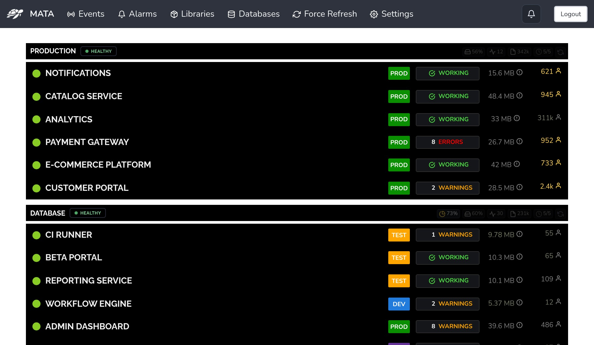
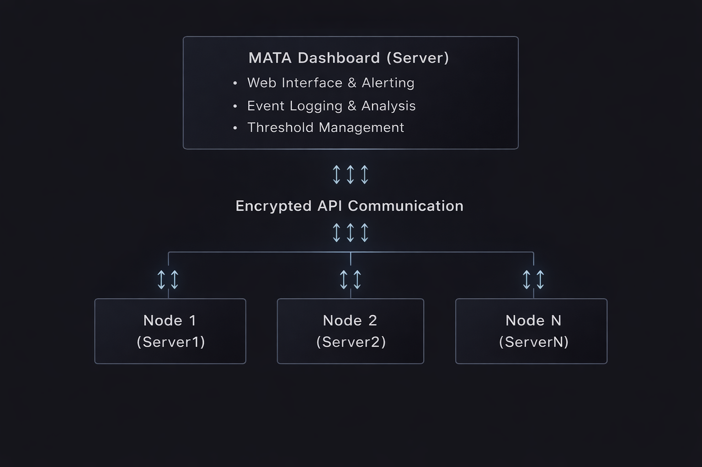

# MATA Dashboard

    

<strong>Monitoring Anomalies & Tracking Alerts</strong>

    

## What is MATA?

MATA Dashboard is a PHP-based monitoring platform for centralized visibility across multiple servers and hosted applications. It provides real-time checks, intelligent alerting, and structured event logging.

- Minimal dependencies
- Resilient under failure
- Built for PHP applications

### Architecture

    

## Key Features

<!-- - Server monitoring: CPU, RAM, disk, and processes -->
- Application health: HTTP checks, logs, session tracking
- Intelligent alerting: threshold rules with notifications
- Security: HMAC-signed API, rate limits, read-only nodes
- Event logging: configurable retention and severity

## Start Here

- [Quick Start](guides/quickstart.md)
- [Docker Deployment](guides/docker-deployment.md)
- [First Server](guides/first-server.md)

## Docs

- [Configuration](guides/configuration.md)
- [Security](guides/secure-application.md)
- [Setup Dev](development/setup-development.md)

## Contact

- **xarc** - [@xarcdev](https://x.com/xarcdev) - mata@xarc.dev
- Project: [mata.sh/mata-dashboard](https://github.com/mata-sh/mata-dashboard)
